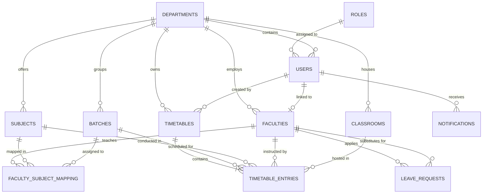

# Database Entity-Relationship (ER) Diagram

## Schema Entities Summary

1. **roles**: Defines authorization levels (`ROLE_SUPER_ADMIN`, `ROLE_ADMIN`, `ROLE_HOD`, `ROLE_FACULTY`).
2. **departments**: Engineering branches (CSE, ECE, EEE, MECH, CIVIL) and HOD names.
3. **users**: User account credentials with BCrypt password hashes and JWT auth metadata.
4. **faculties**: Teacher profiles, faculty codes, designations, max workload hours, and current assignment count.
5. **subjects**: Theory and Laboratory course definitions, semester placement, credits, and weekly period requirements.
6. **classrooms**: Physical lecture halls and laboratories, seating capacities, and building locations.
7. **batches**: Student cohorts, section divisions (Sec A/B), and student strength.
8. **timetables**: Generated timetable headers, fitness score, conflict count, and status flags.
9. **timetable_entries**: Specific day/period/room/faculty schedule slots (Monday to Saturday, 8 periods).
10. **leave_requests**: Leave applications, approval status, and automatic substitute teacher assignments.
